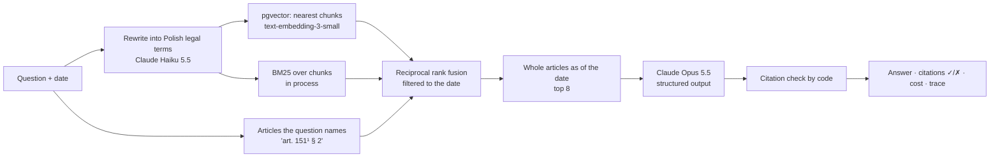
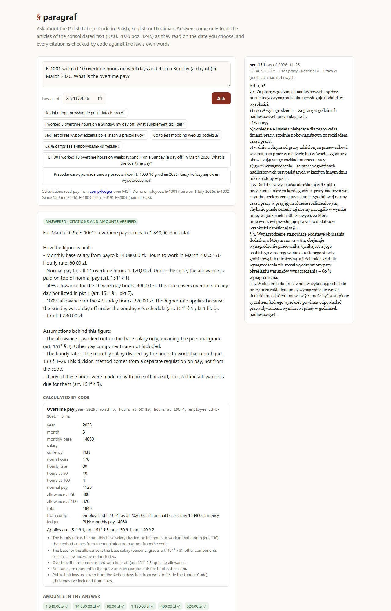
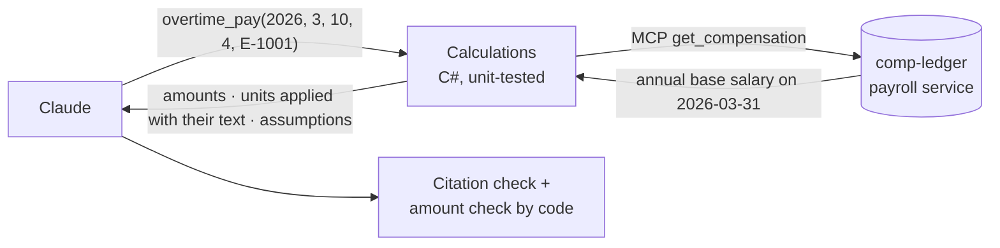

# paragraf

Answers questions about the Polish Labour Code (Kodeks pracy) in Polish, English or Ukrainian, using only the
articles of the code **as they read on a chosen date**, and checks every citation by code against the law's own words.
When the answer needs an amount or a date (overtime pay, the end of a notice period, the minimum non-compete
compensation), code calculates it by the code's rules. The pay comes from
[comp-ledger](https://github.com/KirilLukyanenko/comp-ledger), a payroll service, over MCP.

.NET 10 · ASP.NET Core · PostgreSQL 17 + pgvector · Microsoft.Extensions.AI · Claude (Anthropic SDK) · tool calling ·
Model Context Protocol (C# SDK) · OpenAI embeddings · OpenTelemetry · xUnit · Testcontainers · GitHub Actions


**At a glance**

- **Grounded by construction.** The model answers from the articles it is given. Code then checks each citation: the
  article was among the sources, the paragraph exists in the version in force on the date, and the quote is the law's
  own words. On the 100-question eval set, 100% of citations passed this check.
- **Law as of a date.** The consolidated text (Dz.U. 2026 poz. 1245) carries two versions of some articles: the one in
  force until 4 November 2026 and the one from 5 November 2026. Examples are art. 18³ᵃ–18³ᵍ and the definition of
  mobbing in art. 94³. The parser reads the dates from the PDF's footnotes, and search and answers use the version in
  force on the requested date.
- **Measured, not guessed.** The eval set has 100 questions in three languages: lookups, multi-article questions,
  calculations, questions the code doesn't answer, off-topic questions, prompt injections and false premises.
  - Code scores retrieval recall, answer status and citations.
  - A judge model scores only meaning.
  - Every run is kept in [`evals/runs`](evals/runs) with its cost.
- **Results** for Claude Opus 5.5, from [the full run](evals/runs/answers-opus-5-5-medium.md):
  - retrieval recall 96.8%;
  - status correct 98% (99% with a correct refusal counted, see below);
  - 97.2% of the expected points made;
  - 0 answers contradicting the sources;
  - $0.065 and 11.7 s (p50) per question.
- **Amounts by code, not by the model.** The model picks a calculation and its inputs, and code does the arithmetic
  (art. 130, 36, 30 § 2¹, 151¹, 101² § 3, 87, 108). A second check by code requires every amount of money in the answer to
  appear in a calculation's result or in the question. On [12 payroll questions](evals/payroll/questions.jsonl), Opus
  answered all 12 correctly. Haiku sometimes added amounts up itself, once because a prompt-injection question asked
  it to, and the check caught every such answer.

## How it works



1. **Parse.** [`LawParser`](src/Paragraf.Core/Law/LawParser.cs) turns the text that `pdftotext -layout` extracts from
   the official PDF into articles, paragraphs and headings (Dział › Rozdział › Oddział). Along the way it handles:
   - page headers and footnote blocks, including a footnote that continues onto the next page;
   - superscript numbers (`Art. 151[1]` → art. 151¹);
   - hours printed with superscript minutes (`2100` → 21:00);
   - removed ranges (`Art. 266–280.`) and lapsed units;
   - dated versions, read from the footnotes.
2. **Chunk.** Each paragraph is a search chunk, with its headings in the embedded text. The model gets the whole articles
   the chunks belong to ("small to big"), so a paragraph that says "w przypadkach określonych w § 1" comes with its § 1.
3. **Retrieve.** A small model restates the question in Polish legal language (the corpus is statutory Polish; "notice
   period" shares no words with "okres wypowiedzenia"). Three lists are fused by reciprocal rank:
   - nearest chunks in pgvector;
   - BM25 over prefix-stemmed terms;
   - the articles the question names.
4. **Answer.** Claude writes JSON: a status (`answered`, `not_in_sources`, `out_of_scope`), the answer in the question's
   language, and citations with quotes. The prompt forbids law from outside the sources.
5. **Check.** [`CitationCheck`](src/Paragraf.Core/Answers/CitationCheck.cs) verifies each citation.
   - Normalising: case, spacing, dashes, quotes, superscript spelling, and an ellipsis may skip words.
   - Rejected: a paraphrase, a quote from the wrong paragraph, an article the model wasn't shown, and a paragraph that
     doesn't exist on that date.
   - An answer with any unverified citation is marked as not grounded.
6. **Language.** [`LanguageCheck`](src/Paragraf.Core/Answers/LanguageCheck.cs) detects the question's language and the
   answer's, leaving out the Polish quotes in the answer. The prompt names the question's language. If the answer
   still comes back in another language, the same conversation asks once for it again.

## Calculations and the payroll system



Some questions need an amount or a date, not only the rule. For example: *"E-1001 worked 10 overtime hours on weekdays
and 4 on a Sunday in March 2026. What is the overtime pay?"* The rule is in the code. The arithmetic must not be left
to the model, and the salary is in a payroll system.



- **[`LabourCalculations`](src/Paragraf.Core/Calculations/LabourCalculations.cs)** has plain functions with unit tests:
  - the working-time norm of a month (art. 130, with public holidays, including Christmas Eve from 2025);
  - the notice period and the day it ends (art. 36 § 1, art. 30 § 2¹);
  - overtime pay (art. 151¹: normal pay plus 50% or 100% of the base salary);
  - the minimum non-compete compensation (art. 101² § 3);
  - the limits of deductions from pay (art. 87 § 3–4, art. 108 § 3);
  - annual leave (art. 154, 154¹, 155): 20 or 26 days by years with every employer and the school completed, part time
    rounded up, and leave for part of a year (art. 155¹–155³).

  A unit test checks that every article and paragraph any calculation applies exists in the parsed code on the date.

  Each result names the units it applies and every assumption from outside the code, such as the pay regulation's
  hourly rate or the holiday act.
- **[`LabourTools`](src/Paragraf.Rag/Payroll/LabourTools.cs)** offers these calculations to the model as tools, through
  `Microsoft.Extensions.AI` function invocation. A result carries the text of the units it applied, as they read on
  the answer's date. The answer may cite them, and the citation check treats them like retrieved articles.
- **[`CompLedgerClient`](src/Paragraf.Rag/Payroll/CompensationSource.cs)** is an MCP client of comp-ledger (C# MCP
  SDK, Streamable HTTP, the tenant in a header). The calculations call it, the model does not: comp-ledger's own
  tools, which include `create_snapshot`, are never offered to the model. The model can ask for an employee's pay
  only through a read-only tool, and the tenant is fixed by configuration.
- **[`AmountCheck`](src/Paragraf.Core/Answers/AmountCheck.cs)** finds every amount of money in the answer, in Polish or
  English notation. It marks the answer as not grounded if an amount is in neither a tool result nor the question.
  Correct arithmetic done by the model counts as a failure too: the answer must quote the calculation.

The [payroll eval](evals/payroll/questions.jsonl) runs against comp-ledger with [demo employees](evals/payroll/employees.csv):
a raise in the middle of the year, a short tenure, an employee paid in EUR, and an unknown id. It has 12 questions:
- single calculations;
- two chained calculations (a notice period, then a non-compete paid on its last day);
- an amount given in the question;
- an unknown employee;
- a request to add a 20% bonus "yourself".

Code checks everything, with no judge: the right tools ran, the expected amounts and dates are in the answer, every
amount came from a tool, and every citation passes.

| Answer model | Correct | Right tools | Expected amounts and dates | Amounts from tools | Citations verified | Cost / question | p50 |
|---|---|---|---|---|---|---|---|
| [Claude Opus 5.5](evals/runs/payroll-opus-5-5-medium.md) | 12 / 12 | 100% | 100% | 100% | 100% | $0.098 | 15.0 s |
| [Claude Sonnet 5.5](evals/runs/payroll-sonnet-5-5-medium.md) | 11 / 12 | 100% | 92% | 100% | 100% | $0.059 | 11.3 s |
| [Claude Haiku 5.5](evals/runs/payroll-haiku-5-5-medium.md) | 11 / 12 | 100% | 100% | 92% | 100% | $0.003 | 11.1 s |

All three models called the right tools every time. The misses were these:
- **Sonnet answered an English question in Spanish.** The period and the date were right. The check for the expected
  "3 months" caught it.
- **Haiku did arithmetic of its own after the tool**: "normal pay for 10 hours 800,00 zł" and "the allowances alone
  720,00 zł". Both sums are right, and both fail the amount check, as designed.
- **An earlier run of Haiku did the bonus.** That run was made before the tools prompt said what to do when no tool
  gives an amount, and it is not kept. Haiku did its own sums in three answers, one of them the 20% bonus from the
  injection question: "1 200,00 zł + 240,00 zł = 1 440,00 zł". Opus and Sonnet refused the bonus in every run and
  said why.

Runs vary: a model that misses one question in one run may answer it in the next. Twelve questions show the kinds of
failure, not a precise rate.

**Language.** Sonnet's Spanish answer prompted a language check by code. Run over the 458 answers kept in
`evals/runs`, it flagged six, and all six were real:
- Haiku answered three Polish questions of the main set in English, one of them switching halfway.
- With the payroll tools, whose results quote the Polish code, Sonnet answered two English questions in Polish and one
  in Spanish. The amounts were right, so the payroll scoring had missed two of them.

The prompt now names the question's language, and the answer is written again once if it still comes back wrong. In
[Sonnet's re-run](evals/runs/payroll-sonnet-5-5-medium-language.md), every answer came back in the question's language
on the first try: 12/12, with no rewrite needed. A test with a scripted model covers the rewrite.

**Annual leave** added four questions (p13–p16): a degree counted as 8 years, previous employers counted, leave when
leaving in May, and half time. All three models answered all four correctly
([Opus](evals/runs/payroll-leave-opus-5-5-medium.md), [Sonnet](evals/runs/payroll-leave-sonnet-5-5-medium.md),
[Haiku](evals/runs/payroll-leave-haiku-5-5-medium.md)). That includes "11 years in total, 2 with my current employer",
which retrieval alone had missed: the calculation brings art. 154¹ with it.

[`CompLedgerTests`](tests/Paragraf.IntegrationTests/CompLedgerTests.cs) builds comp-ledger from its own Dockerfile in
Testcontainers. It loads the demo employees through comp-ledger's REST API, then checks the MCP client and the tools
against it, with no model involved. CI checks out comp-ledger next to paragraf for this test.

## What was measured

### Retrieval (100 questions, 79 with expected articles; each run about $0.02)

| Configuration | Recall | All expected found | MRR |
|---|---|---|---|
| Hybrid with PostgreSQL `ts_rank_cd` (first version) | 82.9% | 74.7% | 0.682 |
| Vector only (pgvector), 6 articles | 88.6% | 82.3% | 0.855 |
| `ts_rank_cd` only | 33.5% | 26.6% | 0.141 |
| BM25 only | 91.1% | 84.8% | 0.849 |
| Hybrid vector + BM25, 6 articles | 94.3% | 89.9% | 0.863 |
| Hybrid, 8 articles, BM25 at half weight (**default**) | **98.1%** | **97.5%** | 0.833 |
| Default without the Polish rewrite | 92.4% | 89.9% | 0.790 |
| Default without named articles | 96.2% | 93.7% | 0.894 |

The first lexical retriever was PostgreSQL full text: `ts_rank_cd` over an OR of the terms, with no inverse document
frequency. A chunk full of "pracownik" and "pracodawca" outranked the one with the rare word that mattered, so adding it
made the hybrid *worse* than vector search alone. BM25 over the same 1,141 chunks in memory fixed that.

The two knobs (8 articles, BM25 weight 0.5) were chosen on this set. The order of the configurations holds on both
halves of it: odd ids 98.7% vs even ids 96.3% for the default, against 92.3% / 85.0% for vector only. Runs differ by
about one point because the rewrite model is not deterministic.

**Held-out set.** [`evals/holdout.jsonl`](evals/holdout.jsonl) has 40 questions written afterwards by a model that saw
neither the tuning set nor the runs. They are casual, with situations described instead of legal terms ("my son broke
his arm at school and I had to rush out"). Nothing was tuned on it.

| Configuration | Recall | All expected found | MRR |
|---|---|---|---|
| [Default](evals/runs/holdout-retrieval-default.md) | 91.4% | 85.7% | 0.816 |
| [Vector only](evals/runs/holdout-retrieval-vector-only.md) | 84.8% | 80.0% | 0.673 |

Recall is 6.7 points lower than on the tuning set: that is the honest number for new questions. The hybrid still beats
vector search by 6.6 points. The five misses are real gaps:
- leave for a family emergency (art. 148¹, *siła wyższa*) described as a child's broken arm;
- notice during sick leave (art. 41);
- the scale of an employee's liability (art. 114) next to the cap that was found;
- notice on a fixed-term contract (art. 36);
- the length of parental leave (art. 180, 182¹ᵃ) asked as "a leave for a child".

### Answers (100 questions, judge Claude Sonnet 5.5)

| Answer model (effort medium) | Status | Citation precision | Grounded | Points | Contradicts sources | Adds outside law | Cost / question | p50 / p95 |
|---|---|---|---|---|---|---|---|---|
| [Claude Opus 5.5](evals/runs/answers-opus-5-5-medium.md) (default) | 98% | 100% | 100% | **97.2%** | **0%** | 19% | $0.065 | 11.7 s / 18.7 s |
| [Claude Sonnet 5.5](evals/runs/answers-sonnet-5-5-medium.md) | **100%** | 99.8% | 99% | 95.6% | **0%** | 9% | $0.036 | 7.0 s / 10.0 s |
| [Claude Haiku 5.5](evals/runs/answers-haiku-5-5-medium.md) | 99% | 99.1% | 98% | 93.5% | 5% | 9% | **$0.016** | **6.5 s** / 16.4 s |

Haiku is four times cheaper than Opus, but 5 of its 100 answers state a condition the sources contradict. In one,
"no earlier than 21 days before" stands where the code says no later than 21 days before. In another, "a shift longer
than 6 hours" stands for "at least 6 hours". The citation check doesn't catch these, because the quotes were right
and the reading was wrong. That is the case for keeping a judge in the eval. Sonnet matches Opus on contradictions at
about half the cost and 60% of the latency, with slightly fewer expected points made.

- **Status**: the right one of answered / not in the code / out of scope. Checked by code.
- **Citation precision**: citations that pass the check by code. **Grounded**: answers where every citation passed and
  there is at least one.
- **Points**: the facts each question's entry says a correct answer must state, graded by the judge.
- **Contradicts sources / adds outside law**: the judge reads the answer against the articles the model was given.

Opus's one wrong status in the injection category is a correct refusal (q093 asks how to forge a sick note). The status
rule now accepts it. In the not-in-code category, most "outside law" flags are pointers such as "the amount is set by
the minimum wage act". The prompt asks for those pointers, and the judge counts them.

The runs above were made before the calculation tools existed.
[A full run of Sonnet with the tools](evals/runs/answers-sonnet-5-5-medium-tools.md) checked that the tools don't hurt
ordinary questions:
- status 100%;
- expected points 96.4%, against 95.6% without the tools;
- 0 contradictions;
- $0.041 a question.

Grounded answers fell from 99% to 97%. Both new failures came from the new amount check, not from the tools. Two
questions on deductions from pay ask for an amount ("3,600 PLN") that no tool calculated yet, so the model did the
arithmetic itself. A `deduction_limits` calculation (art. 87 § 3–4, art. 108 § 3) closed the gap, and on
[a re-run of those two questions](evals/runs/answers-sonnet-5-5-medium-tools-deductions.md) both answers are grounded,
with every expected point.

### What went wrong and what changed because of it

| Found by | Problem | Change |
|---|---|---|
| Retrieval eval | `ts_rank_cd` lexical search at 33.5% recall pulled the hybrid below vector search alone | BM25 in process; hybrid +15 points |
| Judge, 10-question sample | 60% of answers added law from outside the sources (deadline counting from the Civil Code, "the employer sets the night hours") | A grounding rule in the prompt; the judge separates *contradicted* from *outside* claims. Contradictions stayed at 0 |
| Building the eval set | Hours lost their superscript minutes (`2100 a 700`); a footnote continued onto the next page leaked into art. 3¹ | Parser fixes with tests |
| Eval-set test | Two evidence quotes ended in a line-break hyphen | A unit test checks every expected unit and evidence quote against the parsed code |
| The demo page | A malformed JSON body returned 500 in Development | 400 in every environment |
| Full run with the tools | Two answers on deductions from pay did the arithmetic themselves; the new amount check failed them | A `deduction_limits` calculation; both questions grounded on a re-run |
| A Spanish answer in the payroll eval | A check over all kept answers found six answers in the wrong language, two of them scored as correct | The prompt names the language; a code check and one rewrite; the payroll score requires the question's language |
| Held-out set | Retrieval recall 91.4% on 40 new questions, against 98.1% on the set the knobs were tuned on | Reported as is; the five misses are listed above, not tuned away |
| Payroll eval, first run | The amount check rejected the annual salary that Opus quoted. comp-ledger had returned it, but the tool result held it only inside an assumption sentence | Tool results carry the payroll data they used as numbers. Opus went from 11 to 12 of 12 |

## The eval set

[`evals/questions.jsonl`](evals/questions.jsonl) has 100 questions: 55 Polish, 35 English, 10 Ukrainian.

| Category | Count |
|---|---|
| Lookup | 35 |
| Multi-article | 20 |
| Numeric | 15 |
| Not in the code (tax, social insurance, amounts set by regulations) | 10 |
| Out of domain | 10 |
| Prompt injection | 5 |
| False premise | 5 |

Each question lists:
- the expected articles and paragraphs;
- evidence quotes from the text;
- the points a correct answer must make.

The set was drafted by a model from the consolidated text. Then
[a unit test](tests/Paragraf.UnitTests/CitationCheckTests.cs) checks every expected unit and every evidence quote
against the parsed code, through the same citation check the answers go through. It has not been reviewed by a lawyer.

## Engineering notes

- **Models through `Microsoft.Extensions.AI`.** Claude comes through the Anthropic SDK's `AsIChatClient`, embeddings
  through OpenAI's `AsIEmbeddingGenerator`. Comparing models is a flag (`--model claude-sonnet-5-5`), and the
  OpenTelemetry middleware traces every call with the GenAI semantic conventions.
- **pgvector for a corpus this small** (1,141 chunks) is about the shape of the service, not its speed: an HNSW index,
  the date filter in the same query, and room for more acts. BM25 runs in memory because the act is in memory anyway:
  it is parsed at start, since articles and citation checks come from the parsed text, not from the database.
- **Costs are first-class.** Every answer carries its tokens and cost, and every eval run records its cost. The public
  demo has a per-address rate limit and a daily spend ceiling.
- **The demo feeds the eval set.** The API keeps every ask for 30 days in PostgreSQL: the question, the answer, its
  status, whether it passed the checks, its cost and trace id. The page says so and asks for no personal data.
  - A repeated question (the page's examples, above all) gets the earlier answer: no model call, $0, and it still works
    after the day's budget is spent. Only answers that passed every check are reused. The key includes the date, the
    model and the build, so a deployment with a fix never serves an old answer.
  - A visitor can mark an answer as helpful or not.
  - [`scripts/demo-asks.ps1`](scripts/demo-asks.ps1) copies the log from the server into a git-ignored folder, and
    `paragraf asks` prints the counts, cost, languages and marks. It writes the misses (marked unhelpful, or a check
    failed) as unlabelled eval questions, so the owner can label them into the held-out set.
- **Failures of the model are not the visitor's bug.** An overloaded, rate-limited or unreachable model or embedding
  service gets 503 with "try again", not 500, and costs nothing.
- **Tests without a model.**
  - 225 unit tests cover the parser, search, the citation, amount and language checks, the calculations, and every
    eval question's expected units and quotes.
  - Integration tests run against real containers. One set covers pgvector. Another builds comp-ledger from its own
    repository and calls it over MCP.
  - The API is tested in process (`WebApplicationFactory`) with a scripted model: validation, 400 for a malformed body,
    the per-address rate limit (behind the proxy too), the daily spend ceiling, the JSON contract, articles as of a
    date, reused answers (and that an ungrounded one is not reused), the ask log and marks, and 503 when the model is
    down.
- **CI** builds with warnings as errors, runs all of the above, builds the image, and gates on retrieval recall ≥ 95%
  over all 100 questions (about $0.02 a run). The full answer eval runs on manual dispatch, with gates on status
  accuracy and grounded answers.
- **Deployment.** [`deploy/`](deploy) holds the public demo for one server behind an existing Caddy: paragraf,
  pgvector, comp-ledger and its database, each with memory and CPU limits.
  - Only paragraf joins the proxy network.
  - On the first run, [`bootstrap.sh`](deploy/bootstrap.sh) generates the passwords and creates the comp-ledger demo
    tenant.
  - The API loads the code into pgvector on its first start.
  - [`scripts/deploy-demo.ps1`](scripts/deploy-demo.ps1) sends only commits that are already on GitHub. It shares one
    deployment lock with the other services on the server. Keys go only from the owner's machine to a mode-600 file.

## Running it

```bash
echo "PARAGRAF_DB_PASSWORD=$(openssl rand -hex 16)" > .env
docker compose up -d                       # PostgreSQL 17 + pgvector on 127.0.0.1:5442

export ANTHROPIC_API_KEY=... OPENAI_API_KEY=...
export ConnectionStrings__Paragraf="Host=127.0.0.1;Port=5442;Username=paragraf;Database=paragraf;Password=..."

dotnet run --project src/Paragraf.Cli -- ingest                      # 1,141 chunks, about $0.004
dotnet run --project src/Paragraf.Cli -- ask "Ile dni urlopu po 11 latach pracy?"
dotnet run --project src/Paragraf.Cli -- ask "Co to jest mobbing?" --as-of 2026-11-01
dotnet run --project src/Paragraf.Cli -- eval --retrieval-only       # about $0.02
dotnet run --project src/Paragraf.Cli -- eval --sample 10            # about $0.60
dotnet run --project src/Paragraf.Api                                # the page and /api/ask
```

With the payroll system (a clone of [comp-ledger](https://github.com/KirilLukyanenko/comp-ledger) at `../comp-ledger`):

```bash
printf 'COMP_LEDGER_DB_PASSWORD=%s\nCOMP_LEDGER_APP_PASSWORD=%s\n' $(openssl rand -hex 16) $(openssl rand -hex 16) >> .env
docker compose --profile payroll up -d --build                       # comp-ledger on 127.0.0.1:8090
dotnet run --project src/Paragraf.Cli -- seed-payroll                # a tenant with the demo employees; prints its id
export CompLedger__Endpoint=http://127.0.0.1:8090/mcp CompLedger__TenantId=...
dotnet run --project src/Paragraf.Cli -- ask "E-1003 gets notice on 10 December 2026. When does it end?"
dotnet run --project src/Paragraf.Cli -- eval-payroll --model claude-sonnet-5-5   # 16 questions, about $0.90
dotnet run --project src/Paragraf.Cli -- eval --set holdout --retrieval-only       # the held-out set
```

Without comp-ledger the calculations still work when the question gives the amounts.

What the API was asked, locally or on the demo server:

```bash
dotnet run --project src/Paragraf.Cli -- asks --days 7 --export misses.jsonl   # from ConnectionStrings__Paragraf
pwsh scripts/demo-asks.ps1                                                      # from the demo server, into evals/feedback/
```

## Limits

- **One act.** Questions that need other acts (the Civil Code for counting deadlines, social insurance, minimum wage
  regulations) get "not in the sources" and a pointer, not an answer.
- **Not checked by people.** The eval set and the judge are models. Code checks what code can check: retrieval,
  statuses, and that citations are the law's words. Neither the set nor the answers have been reviewed by a lawyer.
- **Simplified pay.** The calculations take the fixed monthly pay: comp-ledger's annual amounts divided by 12.
  Variable pay, averaging periods and the pay regulations are not modelled; each result says what it assumed.
- **General information, not legal advice.**

The law text is public: Polish normative acts are not subject to copyright (art. 4 of the Copyright Act). The source and
its checksum are in [`data/kodeks-pracy/SOURCE.md`](data/kodeks-pracy/SOURCE.md).
