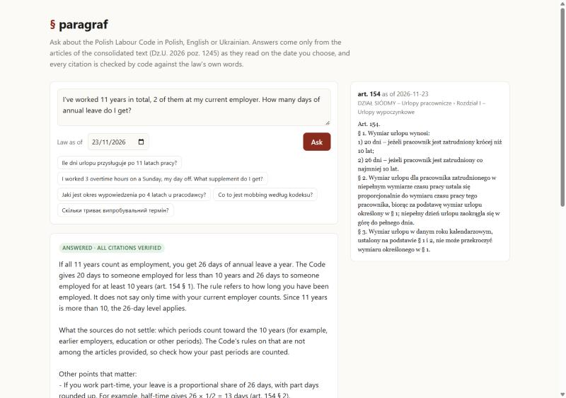
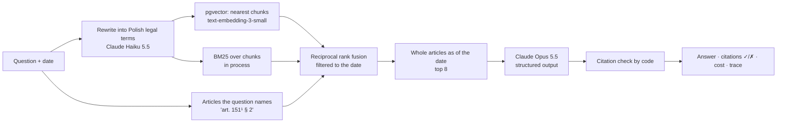

# paragraf

Answers questions about the Polish Labour Code (Kodeks pracy) in Polish, English or Ukrainian, using only the
articles of the code **as they read on a chosen date**, and checks every citation by code against the law's own words.

.NET 10 · ASP.NET Core · PostgreSQL 17 + pgvector · Microsoft.Extensions.AI · Claude (Anthropic SDK) · OpenAI embeddings ·
OpenTelemetry · xUnit · GitHub Actions



**At a glance**

- **Grounded by construction.** The model answers from the articles it is given. Code then checks each citation: the
  article was among the sources, the paragraph exists in the version in force on the date, and the quote is the law's
  own words. On the 100-question eval set, 100% of citations passed this check.
- **Law as of a date.** The consolidated text (Dz.U. 2026 poz. 1245) carries two versions of some articles: the one in
  force until 4 November 2026 and the one from 5 November 2026. Examples are art. 18³ᵃ–18³ᵍ and the definition of
  mobbing in art. 94³. The parser reads the dates from the PDF's footnotes, and search and answers use the version in
  force on the requested date.
- **Measured, not guessed.** The eval set has 100 questions in three languages: lookups, multi-article questions,
  calculations, questions the code doesn't answer, off-topic questions, prompt injections and false premises.
  - Code scores retrieval recall, answer status and citations.
  - A judge model scores only meaning.
  - Every run is kept in [`evals/runs`](evals/runs) with its cost.
- **Results** for Claude Opus 5.5, from [the full run](evals/runs/answers-opus-5-5-medium.md):
  - retrieval recall 96.8%;
  - status correct 98% (99% with a correct refusal counted, see below);
  - 97.2% of the expected points made;
  - 0 answers contradicting the sources;
  - $0.065 and 11.7 s (p50) per question.

## How it works



1. **Parse.** [`LawParser`](src/Paragraf.Core/Law/LawParser.cs) turns the text that `pdftotext -layout` extracts from
   the official PDF into articles, paragraphs and headings (Dział › Rozdział › Oddział). Along the way it handles:
   - page headers and footnote blocks, including a footnote that continues onto the next page;
   - superscript numbers (`Art. 151[1]` → art. 151¹);
   - hours printed with superscript minutes (`2100` → 21:00);
   - removed ranges (`Art. 266–280.`) and lapsed units;
   - dated versions, read from the footnotes.
2. **Chunk.** Each paragraph is a search chunk, with its headings in the embedded text. The model gets the whole articles
   the chunks belong to ("small to big"), so a paragraph that says "w przypadkach określonych w § 1" comes with its § 1.
3. **Retrieve.** A small model restates the question in Polish legal language (the corpus is statutory Polish; "notice
   period" shares no words with "okres wypowiedzenia"). Three lists are fused by reciprocal rank:
   - nearest chunks in pgvector;
   - BM25 over prefix-stemmed terms;
   - the articles the question names.
4. **Answer.** Claude writes JSON: a status (`answered`, `not_in_sources`, `out_of_scope`), the answer in the question's
   language, and citations with quotes. The prompt forbids law from outside the sources.
5. **Check.** [`CitationCheck`](src/Paragraf.Core/Answers/CitationCheck.cs) verifies each citation.
   - Normalising: case, spacing, dashes, quotes, superscript spelling, and an ellipsis may skip words.
   - Rejected: a paraphrase, a quote from the wrong paragraph, an article the model wasn't shown, and a paragraph that
     doesn't exist on that date.
   - An answer with any unverified citation is marked as not grounded.

## What was measured

### Retrieval (100 questions, 79 with expected articles; each run about $0.02)

| Configuration | Recall | All expected found | MRR |
|---|---|---|---|
| Hybrid with PostgreSQL `ts_rank_cd` (first version) | 82.9% | 74.7% | 0.682 |
| Vector only (pgvector), 6 articles | 88.6% | 82.3% | 0.855 |
| `ts_rank_cd` only | 33.5% | 26.6% | 0.141 |
| BM25 only | 91.1% | 84.8% | 0.849 |
| Hybrid vector + BM25, 6 articles | 94.3% | 89.9% | 0.863 |
| Hybrid, 8 articles, BM25 at half weight (**default**) | **98.1%** | **97.5%** | 0.833 |
| Default without the Polish rewrite | 92.4% | 89.9% | 0.790 |
| Default without named articles | 96.2% | 93.7% | 0.894 |

The first lexical retriever was PostgreSQL full text: `ts_rank_cd` over an OR of the terms, with no inverse document
frequency. A chunk full of "pracownik" and "pracodawca" outranked the one with the rare word that mattered, so adding it
made the hybrid *worse* than vector search alone. BM25 over the same 1,141 chunks in memory fixed that.

The two knobs (8 articles, BM25 weight 0.5) were chosen on this set. The order of the configurations holds on both
halves of it: odd ids 98.7% vs even ids 96.3% for the default, against 92.3% / 85.0% for vector only. A held-out set
would be the stronger check. Runs differ by about one point because the rewrite model is not deterministic.

### Answers (100 questions, judge Claude Sonnet 5.5)

| Answer model (effort medium) | Status | Citation precision | Grounded | Points | Contradicts sources | Adds outside law | Cost / question | p50 / p95 |
|---|---|---|---|---|---|---|---|---|
| [Claude Opus 5.5](evals/runs/answers-opus-5-5-medium.md) (default) | 98% | 100% | 100% | **97.2%** | **0%** | 19% | $0.065 | 11.7 s / 18.7 s |
| [Claude Sonnet 5.5](evals/runs/answers-sonnet-5-5-medium.md) | **100%** | 99.8% | 99% | 95.6% | **0%** | 9% | $0.036 | 7.0 s / 10.0 s |
| [Claude Haiku 5.5](evals/runs/answers-haiku-5-5-medium.md) | 99% | 99.1% | 98% | 93.5% | 5% | 9% | **$0.016** | **6.5 s** / 16.4 s |

Haiku is four times cheaper than Opus, but 5 of its 100 answers state a condition the sources contradict. In one,
"no earlier than 21 days before" stands where the code says no later than 21 days before. In another, "a shift longer
than 6 hours" stands for "at least 6 hours". The citation check doesn't catch these, because the quotes were right
and the reading was wrong. That is the case for keeping a judge in the eval. Sonnet matches Opus on contradictions at
about half the cost and 60% of the latency, with slightly fewer expected points made.

- **Status**: the right one of answered / not in the code / out of scope. Checked by code.
- **Citation precision**: citations that pass the check by code. **Grounded**: answers where every citation passed and
  there is at least one.
- **Points**: the facts each question's entry says a correct answer must state, graded by the judge.
- **Contradicts sources / adds outside law**: the judge reads the answer against the articles the model was given.

Opus's one wrong status in the injection category is a correct refusal (q093 asks how to forge a sick note). The status
rule now accepts it. In the not-in-code category, most "outside law" flags are pointers such as "the amount is set by
the minimum wage act". The prompt asks for those pointers, and the judge counts them.

### What went wrong and what changed because of it

| Found by | Problem | Change |
|---|---|---|
| Retrieval eval | `ts_rank_cd` lexical search at 33.5% recall pulled the hybrid below vector search alone | BM25 in process; hybrid +15 points |
| Judge, 10-question sample | 60% of answers added law from outside the sources (deadline counting from the Civil Code, "the employer sets the night hours") | A grounding rule in the prompt; the judge separates *contradicted* from *outside* claims. Contradictions stayed at 0 |
| Building the eval set | Hours lost their superscript minutes (`2100 a 700`); a footnote continued onto the next page leaked into art. 3¹ | Parser fixes with tests |
| Eval-set test | Two evidence quotes ended in a line-break hyphen | A unit test checks every expected unit and evidence quote against the parsed code |
| The demo page | A malformed JSON body returned 500 in Development | 400 in every environment |

## The eval set

[`evals/questions.jsonl`](evals/questions.jsonl) has 100 questions: 55 Polish, 35 English, 10 Ukrainian.

| Category | Count |
|---|---|
| Lookup | 35 |
| Multi-article | 20 |
| Numeric | 15 |
| Not in the code (tax, social insurance, amounts set by regulations) | 10 |
| Out of domain | 10 |
| Prompt injection | 5 |
| False premise | 5 |

Each question lists:
- the expected articles and paragraphs;
- evidence quotes from the text;
- the points a correct answer must make.

The set was drafted by a model from the consolidated text. Then
[a unit test](tests/Paragraf.UnitTests/CitationCheckTests.cs) checks every expected unit and every evidence quote
against the parsed code, through the same citation check the answers go through. It has not been reviewed by a lawyer.

## Engineering notes

- **Models through `Microsoft.Extensions.AI`.** Claude comes through the Anthropic SDK's `AsIChatClient`, embeddings
  through OpenAI's `AsIEmbeddingGenerator`. Comparing models is a flag (`--model claude-sonnet-5-5`), and the
  OpenTelemetry middleware traces every call with the GenAI semantic conventions.
- **pgvector for a corpus this small** (1,141 chunks) is about the shape of the service, not its speed: an HNSW index,
  the date filter in the same query, and room for more acts. BM25 runs in memory because the act is in memory anyway:
  it is parsed at start, since articles and citation checks come from the parsed text, not from the database.
- **Costs are first-class.** Every answer carries its tokens and cost, and every eval run records its cost. The public
  demo has a per-address rate limit and a daily spend ceiling.
- **CI** builds with warnings as errors, runs the unit tests, builds the image, and gates on retrieval recall ≥ 95% over
  all 100 questions (about $0.02 a run). The full answer eval runs on manual dispatch, with gates on status accuracy and
  grounded answers.

## Running it

```bash
echo "PARAGRAF_DB_PASSWORD=$(openssl rand -hex 16)" > .env
docker compose up -d                       # PostgreSQL 17 + pgvector on 127.0.0.1:5442

export ANTHROPIC_API_KEY=... OPENAI_API_KEY=...
export ConnectionStrings__Paragraf="Host=127.0.0.1;Port=5442;Username=paragraf;Database=paragraf;Password=..."

dotnet run --project src/Paragraf.Cli -- ingest                      # 1,141 chunks, about $0.004
dotnet run --project src/Paragraf.Cli -- ask "Ile dni urlopu po 11 latach pracy?"
dotnet run --project src/Paragraf.Cli -- ask "Co to jest mobbing?" --as-of 2026-11-01
dotnet run --project src/Paragraf.Cli -- eval --retrieval-only       # about $0.02
dotnet run --project src/Paragraf.Cli -- eval --sample 10            # about $0.60
dotnet run --project src/Paragraf.Api                                # the page and /api/ask
```

## Limits

- **One act.** Questions that need other acts (the Civil Code for counting deadlines, social insurance, minimum wage
  regulations) get "not in the sources" and a pointer, not an answer.
- **Not checked by people.** The eval set and the judge are models. Code checks what code can check: retrieval,
  statuses, and that citations are the law's words. Neither the set nor the answers have been reviewed by a lawyer.
- **General information, not legal advice.**

The law text is public: Polish normative acts are not subject to copyright (art. 4 of the Copyright Act). The source and
its checksum are in [`data/kodeks-pracy/SOURCE.md`](data/kodeks-pracy/SOURCE.md).
